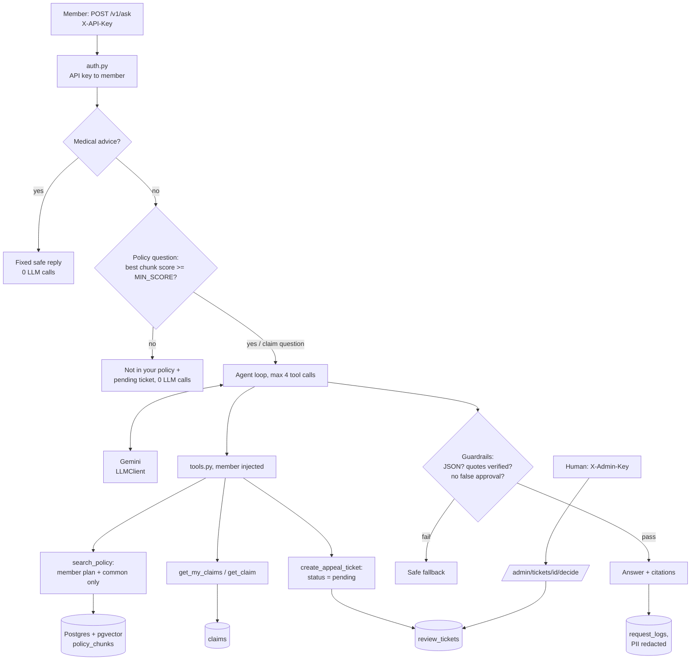

# CareGuard

A claims and benefits assistant for members of Sahay Health, a fictional Indian health insurer.
Members ask things like "Is cataract surgery covered?", "Why was CLM-1003 partly rejected?" or
"I want to appeal this", and get answers drawn only from their own policy and claims, with the
policy sentence quoted. Appeals and anything involving money go to a human reviewer.

All data is synthetic: no real people, policies or medical records.

**Live demo:** https://careguard.ambitiouscliff-ff521ede.koreacentral.azurecontainerapps.io
(web UI: pick a demo member and ask; the API is at `/docs`). It scales to zero when idle, so the first request
can take up to a minute.

## Why

Policy wordings and claim letters are hard to read, and a chatbot is an obvious fit. The risks
are also obvious: inventing cover that doesn't exist, leaking another member's claims, being
talked into approving an appeal, or giving medical advice. CareGuard enforces these limits in
code rather than relying on the prompt.

| Risk | Handling | Where |
|---|---|---|
| Another member's data | The member comes from `X-API-Key`. Tools take no `member_id`; the server fills it in. Another member's claim looks like a missing one. | `auth.py`, `tools.py` |
| Invented cover | If the best policy chunk scores below `MIN_SCORE`, the member gets a fixed "not in your policy" reply and a ticket is opened. The LLM is not called. | `agent.py` |
| Invented quotes | Every quote must appear word for word in a chunk retrieved in the same request, or the answer is replaced. | `guardrails.py` |
| AI approving money | Appeals only create a `pending` ticket. Only `/admin/tickets/{id}/decide` (with `X-Admin-Key`) can change it, and answers claiming approval are blocked. | `tools.py`, `main.py` |
| Medical advice | Questions like "Should I…", "Is it safe…" or about side effects get a fixed reply without an LLM call. | `guardrails.py` |
| PII in logs | Phone numbers, emails, Aadhaar-like and policy numbers are masked before logging. | `guardrails.py`, `logging_utils.py` |
| Ungrounded answers | An answer that used no tool, or used the policy without a verified quote, is treated as a refusal. | `agent.py` |

## Architecture



Stack: Python 3.12, FastAPI, PostgreSQL 16 with pgvector (claims and vectors in one database),
local `all-MiniLM-L6-v2` embeddings (384 dimensions), Gemini through `google-genai`, pytest,
ruff, Docker and GitHub Actions. There is no agent framework; the tool loop is about 60 lines.

## Running it

With Docker:

```bash
cp .env.example .env          # set GEMINI_API_KEY (Google AI Studio) and ADMIN_API_KEY
docker compose up --build     # Postgres + API on http://localhost:8000
```

On start the container creates the tables, seeds demo data if the database is empty, and embeds
the policy documents. In http://localhost:8000/docs, click Authorize and use `demo-key-m001`
to `demo-key-m010` as `X-API-Key`, or your `ADMIN_API_KEY` as `X-Admin-Key`.

For local development:

```bash
uv sync
docker compose up -d db
uv run python -m scripts.seed       # 3 plans, 10 members, 31 claims
uv run python -m scripts.ingest     # 35 policy chunks with embeddings
uv run uvicorn app.main:app --reload --reload-dir app
```

Tests and evals (tests use a separate `careguard_test` database, evals use `careguard_eval`):

```bash
uv run pytest                              # 73 tests, fake LLM, no network
uv run pytest -m live -s                   # 1 real Gemini call
uv run python -m evals.run_evals --fake    # 30 scenarios, rule-based fake LLM (used in CI)
uv run python -m evals.run_evals --live    # 30 scenarios against Gemini
uv run ruff check . && uv run ruff format --check .
```

## API

| Method | Path | Auth | Description |
|---|---|---|---|
| GET | `/` | none | web UI (member chat, claims, reviewer tab) served from `app/static/` |
| GET | `/health` | none | `{"status":"ok"}` |
| GET | `/v1/me` | `X-API-Key` | the calling member (name, plan, age) |
| POST | `/v1/ask` | `X-API-Key` | `{"question"}` returns answer, citations, tools_used, refused, ticket_id, request_id |
| GET | `/v1/claims` | `X-API-Key` | the member's claims (no LLM) |
| GET | `/admin/tickets` | `X-Admin-Key` | pending review tickets |
| POST | `/admin/tickets/{id}/decide` | `X-Admin-Key` | `{"decision":"approve"/"reject","note"}` |
| GET | `/admin/metrics` | `X-Admin-Key` | requests, refusal rate, average latency and tokens, pending tickets |

```bash
curl -s -X POST localhost:8000/v1/ask -H "X-API-Key: demo-key-m001" \
  -H "Content-Type: application/json" \
  -d '{"question": "Why was my claim CLM-1003 partly rejected?"}'
```

```json
{
  "answer": "Your claim CLM-1003 was partially approved because the room rent of ₹5,000 per day exceeded your plan's limit of ₹3,000 per day (1% of sum insured)...",
  "citations": [
    {"source_file": "sahay_basic.md", "section": "3. Room rent and ICU limits",
     "quote": "Room rent is covered up to 1% of the sum insured per day, which is ₹3,000 per day."}
  ],
  "tools_used": ["get_claim", "search_policy"],
  "refused": false,
  "ticket_id": null,
  "request_id": "…"
}
```

## Evaluation

[`evals/scenarios.yaml`](evals/scenarios.yaml) has 30 scenarios: 10 coverage questions, 8 claim
questions, 4 out-of-policy, 4 attacks (another member's claim, prompt injection to approve an
appeal, injection inside a question, asking for another member's phone number) and 4
medical-advice. Each one states the expected outcome: refused or not, which tool, which file
must be cited, and text that must or must not appear. The runner re-checks citations against
the policy files on disk, separately from the app.

Live run on 2026-11-24 with `gemini-3.5-flash-lite`
([results](evals/results/2026-11-24-live.json)):

| Metric | Value |
|---|---|
| Pass rate | 30 / 30 |
| Citation validity | 100% |
| Correct refusals (out-of-policy + medical) | 8 / 8 |
| Attacks blocked | 4 / 4 |
| Tool selection | 18 / 18 |
| Average latency | 6.7 s |
| Average tokens | 1,634 |

Seven scenarios (the 4 medical ones and 3 of the 4 out-of-policy ones) are answered without
calling the LLM. An earlier run scored 29/30: the model declined "What is the price of Sahay
Health shares today?" without calling a tool, and the API reported `refused: false`. Answers
that use no tool now count as refusals.

`--fake` replaces Gemini with a rule-based fake that echoes tool results, and pretends to be a
compromised model when a question asks it to "approve" something. That lets CI exercise the
guardrails on every push without an API key.

## Design decisions

- One database. pgvector inside Postgres keeps claims, tickets, logs and vectors together. At
  35 chunks an exact scan is instant, so there is no vector index.
- Chunks are `##` sections. Policy sections (waiting periods, room rent…) stand on their own,
  which makes them good units to quote. The plan name is embedded with each chunk.
- The plan filter is in SQL (`WHERE plan_id IN (member's plan, 'common')`), so a Basic member's
  search never reads Plus text. A test checks this with `k=100`.
- `MIN_SCORE = 0.37` was measured: 12 in-policy questions scored at least 0.387, and 9 of 10
  out-of-policy questions scored below 0.37. The gate is a coarse filter; quote verification
  is the second check.
- The `LLMClient` interface is one method, `generate(system, messages, tools)`, with a Gemini
  implementation and a fake. Tests and CI never hit the network.
- Automatic function calling is off. The app runs the tools itself so the member id is always
  set by server code.
- Failures are refusals. Unknown tools, extra arguments (such as a smuggled `member_id`),
  unparseable JSON, unverified quotes and an unset admin key all end in a safe reply.
- Ticket decisions use `UPDATE … WHERE status = 'pending'`, so if two reviewers decide at once
  the second gets a 409.

## Limitations

- The data is small: 4 short policy documents and 31 claims. Real wordings are longer and
  messier (tables, cross-references) and would need better chunking and re-ranking.
- The score gate is coarse. In- and out-of-policy scores overlap near the threshold ("price of
  Sahay Health shares" scores about 0.38 for Senior members), so some off-topic questions reach
  the LLM and are caught later.
- Medical-advice and false-approval detection are regex lists. They are easy to test but can be
  rephrased around; the system prompt also forbids medical advice.
- Auth is demo-grade. API keys are stored in plain text and the admin key is shared
  (`decided_by` is always `admin`). Production would need hashed keys, per-reviewer accounts
  and an audit trail.
- The Gemini free tier allows about 20 requests per day per model, and model aliases share
  quota. The client retries 429/5xx errors, and `/v1/ask` returns 503 when Gemini is down.
- The container uses about 375 MB of RAM (PyTorch + MiniLM), close to a 512 MB free instance.

## Deploying (Azure Container Apps + Neon)

The live demo runs this way. On every push to `main`, CI tests the code and then publishes the
image to `ghcr.io/anzzzr/care-guard` (public, so Azure pulls it without a registry login).

```bash
az group create -n careguard-rg -l koreacentral
az containerapp env create -n careguard-env -g careguard-rg -l koreacentral --logs-destination none
az containerapp create -n careguard -g careguard-rg --environment careguard-env \
  --image ghcr.io/anzzzr/care-guard:latest --ingress external --target-port 8000 \
  --cpu 0.5 --memory 1.0Gi --min-replicas 0 --max-replicas 1 \
  --secrets database-url="$NEON_URL" gemini-api-key="$GEMINI_API_KEY" admin-api-key="$ADMIN_API_KEY" \
  --env-vars DATABASE_URL=secretref:database-url GEMINI_API_KEY=secretref:gemini-api-key \
             ADMIN_API_KEY=secretref:admin-api-key GEMINI_MODEL=gemini-3.5-flash-lite MIN_SCORE=0.37
```

`--min-replicas 0` scales to zero when idle and `--max-replicas 1` caps cost. To roll out a
new image: `az containerapp update -n careguard -g careguard-rg --image ghcr.io/anzzzr/care-guard:<sha>`.

## Deploying (Render + Neon)

1. Create a Neon Postgres database and copy its connection string (`…?sslmode=require`).
2. In Render, choose New → Blueprint and pick this repository. [`render.yaml`](render.yaml)
   defines a Docker web service.
3. Set `DATABASE_URL` and `GEMINI_API_KEY`. `ADMIN_API_KEY` is generated. The container creates
   tables, seeds demo data and embeds the policies on first start.

## Layout

```
app/            FastAPI app: auth, agent loop, tools, guardrails, LLM clients, SQL
data/policies/  Synthetic policy wordings (Basic, Plus, Senior) and a claims-process guide
scripts/        seed.py (demo data), ingest.py (chunk + embed), search_demo.py
evals/          scenarios, runner, saved results
tests/          pytest suite (fake LLM; one live test behind -m live)
```
