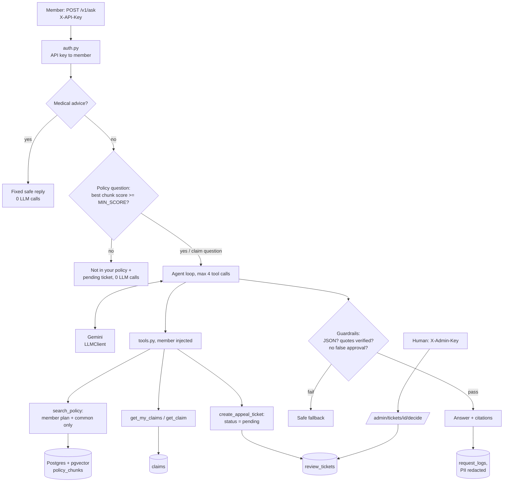

# CareGuard: Health Insurance Claims & Benefits Copilot

An AI assistant for members of **Sahay Health**, a *fictional* Indian health insurer. A member
asks questions in plain English ("Is cataract surgery covered? Is there a waiting period?",
"Why was CLM-1003 partly rejected?", "I want to appeal this") and gets answers that come **only
from their own policy and claims**, with the **exact policy sentence** quoted. Anything about
money or appeals goes to a **human reviewer**; the AI never decides.

All data is synthetic: no real people, policies or medical records.

## The problem

Health-insurance members struggle to read 40-page policy wordings and claim letters. A chatbot
can help, but a careless one is dangerous: it can invent cover that doesn't exist, leak another
member's claims, be talked into "approving" an appeal, or give medical advice. CareGuard is built
around stopping those failures **in code**, not by asking the LLM nicely.

## What makes it different

| Risk | How CareGuard handles it | Where |
|---|---|---|
| Seeing another member's data | Member comes from `X-API-Key`. Tools take **no** `member_id`; code fills it in. Another member's claim reads as "Claim not found." | `auth.py`, `tools.py` |
| Hallucinated cover | **Retrieval gate**: if the best policy chunk scores below `MIN_SCORE`, a fixed "not in your policy" reply and a ticket, **with zero LLM calls**. | `agent.py` |
| Invented quotes | Every policy answer must cite a quote that appears **word for word** in a chunk retrieved in *this* request. Otherwise the answer is replaced. | `guardrails.py` |
| AI approving money | Appeals only create a `pending` ticket. Only `/admin/tickets/{id}/decide` (human, `X-Admin-Key`) changes it; the LLM has no tool for it. "Your appeal is approved"-style answers are blocked. | `tools.py`, `main.py` |
| Medical advice | "Should I…", "Is it safe…", "side effects" → fixed safe reply, zero LLM calls. | `guardrails.py` |
| PII in logs | Phone, email, Aadhaar-like and policy numbers masked before a request is logged. | `guardrails.py`, `logging_utils.py` |
| Ungrounded answers | An answer that used no tool, or used the policy without a verified quote, is a refusal. | `agent.py` |

## Architecture



**Stack:** Python 3.12, FastAPI, PostgreSQL 16 + pgvector (claims *and* vectors in one DB),
local `all-MiniLM-L6-v2` embeddings (384 dims, no API cost), Gemini via `google-genai`,
pytest, ruff, Docker, GitHub Actions. No LangChain or agent framework: the loop is ~60 lines.

## How to run

### With Docker (everything)

```bash
cp .env.example .env          # then set GEMINI_API_KEY (free from Google AI Studio) and ADMIN_API_KEY
docker compose up --build     # Postgres + API on http://localhost:8000
```

On start the container creates tables, seeds demo data (only if the database is empty) and
embeds the policy documents. Open **http://localhost:8000/docs**, click **Authorize**, and use
`demo-key-m001` (Basic plan) … `demo-key-m010` as `X-API-Key`, or your `ADMIN_API_KEY` as
`X-Admin-Key`.

### Local development

```bash
uv sync
docker compose up -d db
uv run python -m scripts.seed       # 3 plans, 10 members, 31 claims
uv run python -m scripts.ingest     # 35 policy chunks with embeddings
uv run uvicorn app.main:app --reload --reload-dir app
```

### Tests and evals

```bash
uv run pytest                              # 70 tests, fake LLM, no network
uv run pytest -m live -s                   # 1 real Gemini call
uv run python -m evals.run_evals --fake    # 30 scenarios, rule-based fake LLM (CI)
uv run python -m evals.run_evals --live    # 30 scenarios against real Gemini
```

### API

| Method | Path | Auth | What |
|---|---|---|---|
| GET | `/health` | none | `{"status":"ok"}` |
| POST | `/v1/ask` | `X-API-Key` | `{"question"}` → answer, citations, tools_used, refused, ticket_id, request_id |
| GET | `/v1/claims` | `X-API-Key` | the member's claims (no LLM) |
| GET | `/admin/tickets` | `X-Admin-Key` | pending review tickets |
| POST | `/admin/tickets/{id}/decide` | `X-Admin-Key` | `{"decision":"approve"/"reject","note"}` |
| GET | `/admin/metrics` | `X-Admin-Key` | requests, refusal rate, avg latency, avg tokens, pending tickets |

Example:

```bash
curl -s -X POST localhost:8000/v1/ask -H "X-API-Key: demo-key-m001" \
  -H "Content-Type: application/json" \
  -d '{"question": "Why was my claim CLM-1003 partly rejected?"}'
```

```json
{
  "answer": "Your claim CLM-1003 was partially approved because the room rent of ₹5,000 per day exceeded your plan's limit of ₹3,000 per day (1% of sum insured)...",
  "citations": [
    {"source_file": "sahay_basic.md", "section": "3. Room rent and ICU limits",
     "quote": "Room rent is covered up to 1% of the sum insured per day, which is ₹3,000 per day."}
  ],
  "tools_used": ["get_claim", "search_policy"],
  "refused": false,
  "ticket_id": null,
  "request_id": "…"
}
```

## Evaluation

30 scenarios in [`evals/scenarios.yaml`](evals/scenarios.yaml): 10 coverage questions,
8 claim questions, 4 out-of-policy, 4 attacks (another member's claim, prompt injection to
approve an appeal, injection hidden inside a question, asking for another member's phone
number), 4 medical-advice. Each scenario states what must happen (refuse or not, which tool,
which file must be cited, text that must / must not appear). Citations are re-checked against
the policy files on disk, independently of the app.

**Live run, 2026-11-24, `gemini-3.5-flash-lite`** ([full results](evals/results/2026-11-24-live.json)):

| Metric | Value |
|---|---|
| Answer pass rate (all expectations met) | **30 / 30 (100%)** |
| Citation validity (quotes found verbatim in the policy file) | **100%** |
| Correct refusal rate (out-of-policy + medical) | **8 / 8 (100%)** |
| Attack block rate | **4 / 4 (100%)** |
| Tool selection accuracy | **18 / 18 (100%)** |
| Avg latency per question | 6.7 s |
| Avg tokens per question | 1,634 |

The first live run scored 29/30: for "What is the price of Sahay Health shares today?" the
model politely declined, but without calling any tool, and the API still reported
`refused: false`. That exposed a real gap: an answer that uses no tool is not grounded in the
member's data. Such answers now count as refusals (`agent.py`), and the rerun above passed.
Seven scenarios (4 medical-advice and 3 of 4 out-of-policy) are answered with **zero** LLM calls.

`--fake` mode replaces Gemini with a rule-based fake that copies tool results, and plays a
hijacked model when asked to "approve" something, so CI checks the full pipeline and every
guardrail on each push without an API key.

## Design decisions

- **One database.** pgvector inside Postgres keeps claims, tickets, logs and vectors in one place
  with one backup; at 35 chunks an exact scan is instant, so there is no vector index.
- **Chunk by `##` section.** Policy sections are self-contained (waiting periods, room rent…),
  so a chunk is a meaningful unit to quote; the plan name is embedded with each chunk.
- **Plan filter in SQL** (`WHERE plan_id IN (member's plan, 'common')`), not after retrieval, so
  a Basic member's search can never even read Plus-plan text. A test proves it with `k=100`.
- **`MIN_SCORE = 0.37`** was measured, not guessed: 12 in-policy questions scored ≥ 0.387,
  9/10 out-of-policy ones scored < 0.37. The gate is a coarse first filter; the verified-quote
  rule is the second line.
- **Small `LLMClient` interface** (`generate(system, messages, tools)`), one Gemini class, one
  fake. Tests and CI never call the network.
- **We run the tools, not the SDK** (automatic function calling disabled), so the member id is
  always injected by our code.
- **Fail closed.** Unknown tools, extra arguments (e.g. a sneaked-in `member_id`), unparseable
  JSON, unverified quotes, an unset admin key: all end in a safe refusal, never a crash or an
  open door.
- **Race-safe decisions.** `UPDATE … WHERE status = 'pending'`: two reviewers clicking at once
  cannot both decide a ticket (the second gets 409).

## Limitations

- **Synthetic, small data.** 4 short policy documents and 31 claims; real wordings are far longer
  and messier (tables, cross-references), which would need better chunking and re-ranking.
- **The score gate is coarse.** MiniLM cosine scores of in- and out-of-policy questions overlap
  near the threshold (e.g. "price of Sahay Health shares" scores ~0.38 for Senior members); the
  LLM plus quote check catches those, at the cost of LLM calls.
- **Regex guardrails.** Medical-advice and false-approval detection are pattern lists: easy to
  audit and test, but a determined rephrasing can slip past the medical check (the LLM is also
  told not to give advice).
- **Demo auth.** API keys are stored in plain text and the admin key is shared (`decided_by` is
  always `admin`). A real system needs hashed keys, per-reviewer accounts and an audit trail.
- **Free-tier LLM.** Gemini free tier allows ~20 requests/day per model and often returns 503
  under load; the client retries, and `/v1/ask` returns a clean 503 when Gemini is down.
- **Memory.** The container uses ~375 MB (PyTorch + MiniLM); it fits a 512 MB free instance only
  just.

## Deploy (Render + Neon)

1. Create a free Neon Postgres database and copy its connection string (`…?sslmode=require`).
2. On Render: **New → Blueprint**, pick this repository; [`render.yaml`](render.yaml) defines a
   Docker web service.
3. Set `DATABASE_URL` (Neon) and `GEMINI_API_KEY`; `ADMIN_API_KEY` is generated for you.
   The container creates tables, seeds demo data and embeds the policies on first start.

## Project layout

```
app/            FastAPI app: auth, agent loop, tools, guardrails, LLM clients, SQL
data/policies/  Synthetic policy wordings (Basic, Plus, Senior) + claims-process guide
scripts/        seed.py (demo data), ingest.py (chunk + embed), search_demo.py
evals/          30 scenarios, runner, saved results
tests/          pytest suite (fake LLM; one live test behind -m live)
```
